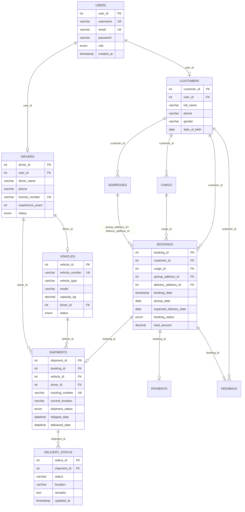

# Cargo Transportation Management System (CTMS)

**Course:** Full-Stack Development - II (FSD-II)  
**Institution:** Lakireddy Bali Reddy College of Engineering (LBRCE), Mylavaram  
**Architecture:** MVC (Model - View - Controller) with Java Servlets, JSP, JDBC & MySQL  

---

## 1. Project Overview

The **Cargo Transportation Management System** is an enterprise-grade web application developed using pure Java Servlets, JSP, and MySQL. It automates end-to-end cargo logistics operations, connecting **Customers**, **Drivers**, and **Administrators** into a unified real-time shipment workflow:

1. **Customers** register, create cargo orders with itemized weights, configure pickup/delivery addresses, track assigned drivers & vehicles, and submit star-rated delivery feedback.
2. **Administrators** verify customer bookings, allocate available fleet vehicles and drivers, generate tracking numbers (`CTMS...`), manage payments, and analyze operational KPIs.
3. **Drivers** log in to view assigned delivery routes, inspect vehicle specifications, and log live milestone transitions (`PICKED_UP` -> `IN_TRANSIT` -> `OUT_FOR_DELIVERY` -> `DELIVERED`).

---

## 2. Technology Stack

- **Backend:** Java 21 LTS, Java EE 8 / Servlet 4.0 (`javax.servlet.*`)
- **Frontend:** HTML5, CSS3 (Custom Blue-and-White Theme), Vanilla JavaScript
- **Database:** MySQL 8.0 (`cargo_db`) on `localhost:3306`
- **Connectivity:** JDBC with MySQL Connector/J (`mysql-connector-j-8.4.0`)
- **Security:** BCrypt Hashing (`jbcrypt-0.4`), Role-Based Filter (`AuthFilter`), Session Invalidation
- **Server:** Apache Tomcat v9.0 (Port `8082`, Context `/CargoTransportationSystem`)
- **IDE & Build:** Eclipse IDE for Enterprise Java / Maven (`pom.xml`)

---

## 3. MVC Architecture & Package Structure

```
CargoTransportationSystem/
├── src/main/java/
│   └── com/cargo/
│       ├── controller/             # Servlets (C in MVC)
│       │   ├── LoginServlet.java
│       │   ├── LogoutServlet.java
│       │   ├── RegisterServlet.java
│       │   ├── CustomerProfileServlet.java
│       │   ├── AddressServlet.java
│       │   ├── CargoServlet.java
│       │   ├── BookingServlet.java
│       │   ├── ShipmentServlet.java
│       │   ├── PaymentServlet.java
│       │   ├── FeedbackServlet.java
│       │   ├── DriverDashboardServlet.java
│       │   ├── DriverShipmentServlet.java
│       │   ├── AdminUserServlet.java
│       │   ├── AdminCustomerServlet.java
│       │   ├── AdminDriverServlet.java
│       │   ├── AdminVehicleServlet.java
│       │   ├── AdminBookingServlet.java
│       │   ├── AdminShipmentServlet.java
│       │   └── AdminReportsServlet.java
│       ├── model/                  # Entity POJOs (M in MVC)
│       │   ├── User.java
│       │   ├── Customer.java
│       │   └── Driver.java
│       ├── dao/                    # Data Access Objects (JDBC Operations)
│       │   └── UserDAO.java
│       ├── filter/                 # Security & RBAC Filters
│       │   └── AuthFilter.java
│       └── util/                   # Connection & Utility Classes
│           ├── DBConnection.java
│           └── TestConnection.java
├── src/main/resources/
│   ├── db.properties               # Externalized DB credentials (git-ignored)
│   └── db.properties.example       # Safe credential template
├── src/main/webapp/
│   ├── css/
│   │   └── style.css               # Shared blue-and-white stylesheet
│   ├── admin/                      # Admin JSP views
│   │   ├── dashboard.jsp
│   │   ├── users.jsp
│   │   ├── customers.jsp
│   │   ├── drivers.jsp
│   │   ├── vehicles.jsp
│   │   ├── bookings.jsp
│   │   ├── shipments.jsp
│   │   ├── reports.jsp
│   │   ├── payments.jsp
│   │   └── feedback.jsp
│   ├── customer/                   # Customer JSP views
│   │   ├── dashboard.jsp
│   │   ├── profile.jsp
│   │   ├── addresses.jsp
│   │   ├── cargo.jsp
│   │   ├── bookings.jsp
│   │   ├── shipments.jsp
│   │   ├── payments.jsp
│   │   └── feedback.jsp
│   ├── driver/                     # Driver JSP views
│   │   └── dashboard.jsp
│   ├── WEB-INF/
│   │   ├── web.xml                 # Web descriptor & filter mappings
│   │   └── lib/                    # MySQL Connector & jBCrypt JARs
│   ├── index.jsp                   # Landing page
│   ├── login.jsp                   # Authentication page
│   └── register.jsp                # Customer registration page
├── pom.xml
└── README.md
```

---

## 4. Database Schema & Entity Relationships

The application connects to **`cargo_db`** containing 11 relational tables:



---

## 5. Demo Credentials (For Testing & Viva Evaluation)

All test user passwords have been pre-configured with standard BCrypt hashing:

| Role | Username | Password | Default Landing Page |
| :--- | :--- | :--- | :--- |
| **Administrator** | `admin_test` | `12345678` | `/admin/dashboard.jsp` |
| **Fleet Driver** | `driver_test` | `12345678` | `/driver/dashboard` |
| **Customer** | `customer_test` | `12345678` | `/customer/dashboard.jsp` |

---

## 6. How to Run the Project in Eclipse

1. Open **Eclipse IDE for Enterprise Java and Web Developers**.
2. Select your workspace: `C:\Users\pasum\eclipse-workspace`.
3. In **Project Explorer**, verify `CargoTransportationSystem` is imported.
4. Ensure MySQL service `MySQL80` is running on port `3306`.
5. Check `src/main/resources/db.properties` has your local credentials.
6. Right-click the project `CargoTransportationSystem` -> **Run As** -> **Run on Server**.
7. Select **Apache Tomcat v9.0** -> Click **Finish**.
8. Open your web browser and navigate to:
   ```
   http://localhost:8082/CargoTransportationSystem/
   ```

---

## 7. Viva Voce Questions & Answers

### Q1: What is the MVC architecture and how did you implement it in this project?
> **Answer:** MVC stands for Model-View-Controller:
> - **Model:** Java entity classes (`User.java`, `Customer.java`, `Driver.java`) and DAOs (`UserDAO.java`) that encapsulate data structures and database business logic.
> - **View:** JSP pages (`login.jsp`, `admin/dashboard.jsp`, `customer/dashboard.jsp`, `driver/dashboard.jsp`) that display the user interface using HTML/CSS.
> - **Controller:** Java Servlets (`LoginServlet`, `BookingServlet`, `DriverShipmentServlet`, etc.) that handle incoming HTTP requests, process user inputs, invoke DAOs, update sessions, and forward or redirect to views.

### Q2: Why did you use `javax.servlet` instead of `jakarta.servlet`?
> **Answer:** Apache Tomcat 9 implements the Java EE 8 specification (Servlet 4.0), which uses the `javax.servlet.*` package namespace. The newer `jakarta.servlet.*` namespace was introduced in Java EE 9 / Jakarta EE 9 and is supported starting from Apache Tomcat 10. Mixing them causes `ClassNotFoundException` or `NoClassDefFoundError`.

### Q3: How is password security implemented?
> **Answer:** Passwords are never stored in plain text. When a customer registers, `RegisterServlet` passes the password to `BCrypt.hashpw(password, BCrypt.gensalt(12))`. BCrypt generates a salted 60-character cryptographic hash with a work factor of 12, protecting user credentials against rainbow table and brute-force attacks.

### Q4: How is Role-Based Access Control (RBAC) enforced?
> **Answer:** RBAC is enforced on the server side using `com.cargo.filter.AuthFilter`. The filter intercepts all requests to `/admin/*`, `/customer/*`, and `/driver/*`. It inspects `session.getAttribute("role")`. If an unauthorized role attempts to access a restricted URL, the filter blocks access and redirects to `login.jsp?error=forbidden`.

### Q5: How do you prevent users from seeing protected pages after logging out using the browser's Back button?
> **Answer:** `AuthFilter` and `LogoutServlet` send HTTP response headers that disable client-side browser caching:
> ```java
> response.setHeader("Cache-Control", "no-cache, no-store, must-revalidate"); // HTTP 1.1
> response.setHeader("Pragma", "no-cache"); // HTTP 1.0
> response.setDateHeader("Expires", 0); // Proxies
> ```
> When the user clicks Logout, `session.invalidate()` clears the server session. If they click "Back", the browser is forced to send a new request to the server, where `AuthFilter` detects the invalidated session and redirects to the login screen.

### Q6: How do you prevent SQL Injection?
> **Answer:** All database operations in our Servlets and DAOs use parameterized `PreparedStatement` with placeholder `?` marks instead of string concatenation. The JDBC driver safely escapes and treats all user inputs as literal values rather than executable SQL commands.

### Q7: What is the purpose of database transactions (`setAutoCommit(false)`)?
> **Answer:** Transactions are used for atomic multi-table operations. For example, when a customer registers, we insert into `users` and initialize a row in `customers`. By wrapping both in `con.setAutoCommit(false)` and calling `con.commit()` only when both succeed (or `con.rollback()` on error), we guarantee database consistency and prevent orphaned user records.
